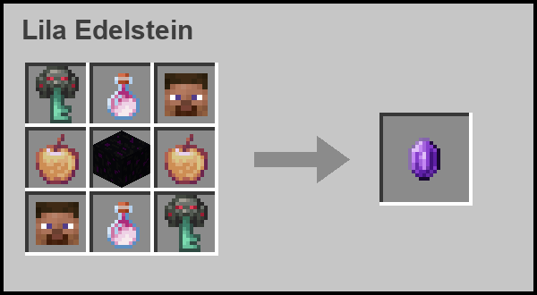
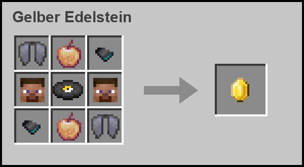
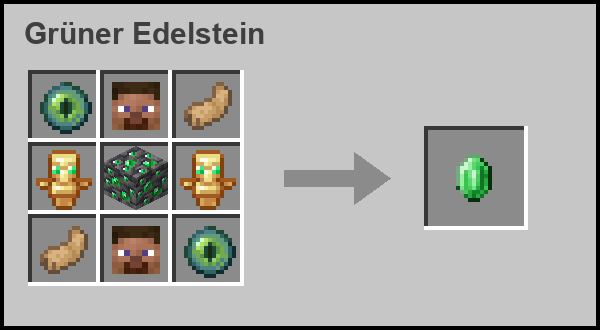
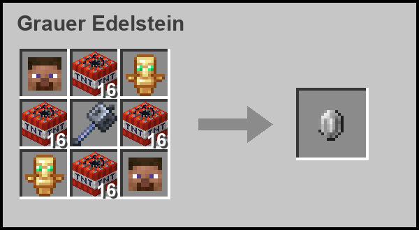
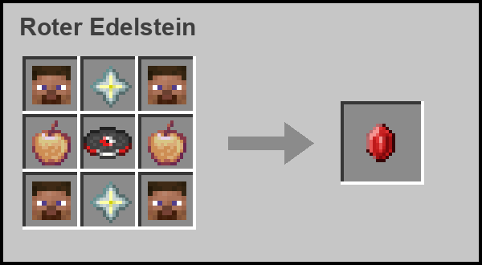
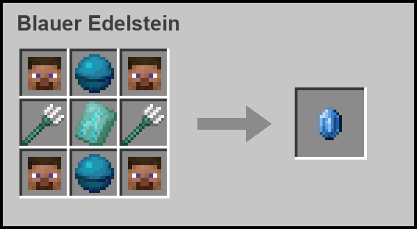
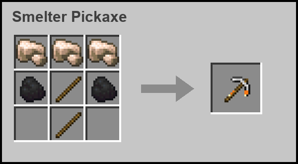
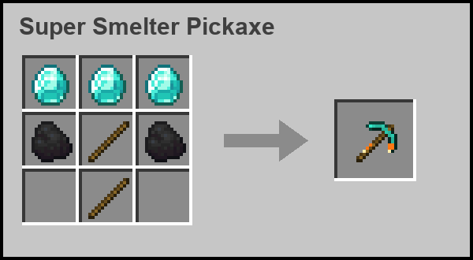
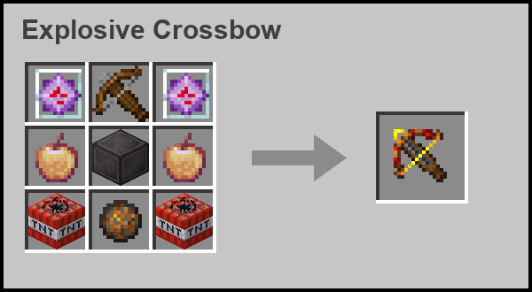
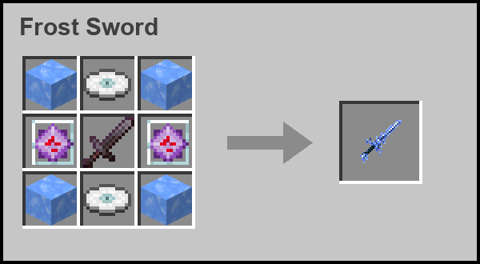

# Gems Mod v3

**Fabric-Mod für Minecraft 1.21.11** – 6 magische Edelsteine mit je 4 Fähigkeiten, besondere Waffen und Werkzeuge, ein neuer Ender-Dragon-Kampf, Teams und Anti-Cheat für SMP-Server.

## ⬇️ Download

**[gems-mod-v3.jar herunterladen](https://github.com/henkefelix88-blip/gems-mod/releases/latest/download/gems-mod-v3.jar)**

**Installation:** Fabric Loader (0.19.3+) und die **Fabric API** für 1.21.11 installieren, dann die `.jar` in den `mods`-Ordner legen. Die Mod läuft serverseitig – Spieler ohne Mod können sich trotzdem verbinden (die eigenen Menüs gibt es dann als Chat/Actionbar).

---

## Kurz erklärt

**Die Edelsteine:** Solange ein Edelstein im Inventar ist, bekommst du seine passiven Effekte. Mit dem Edelstein in der Hand löst du 4 Fähigkeiten aus: **Rechtsklick**, **Schleichen + Rechtsklick**, **Linksklick** und **Schleichen + Linksklick** – jede mit eigenem Cooldown. **Jeder Edelstein kann pro Welt nur ein einziges Mal gecraftet werden.**

| Edelstein | Passiv | Fähigkeiten |
|---|---|---|
| 🟣 **Lila** | Regeneration I, Strength I | Pocket Dimension (eigener Raum), Rift Step (Blink), Dragon's Breath (Strahl), Void Swap (Platz tauschen) |
| 🟡 **Gelb** | Regeneration I, Haste I, Speed I | Chain Lightning, Tracker-Beam (Glowing), Storm Call (Blitz), Thunder Dash |
| 🟢 **Grün** | Hero of the Village, Regeneration I, +3 Herzen | Ranken-Beam (Gift + festwurzeln), Nature's Blessing (Heilung fürs Team), Barkskin, Thorn Volley |
| ⚪ **Grau** | Resistance I, Regeneration I, +5 Herzen | Fangring-Salve, Ground Slam, Petrify (versteinern), Chain Hook (heranziehen) |
| 🔴 **Rot** | Fire Resistance, Regeneration I, Strength I | Wolfsrudel (3 Kampfwölfe), Warcry, Inferno Charge, Fireball Barrage |
| 🔵 **Blau** | Night Vision; im Wasser Dolphin's Grace + 3 Herzen | Tidal Wave, Guardian Pets, Riptide (6 Ladungen), Abyssal Curse |

**Weitere Items:**
- **Player Head** – droppt beim Tod eines Spielers (mit seinem Skin). Essen gibt Regeneration III, Speed II und Strength I. Wird in fast allen Edelstein-Rezepten gebraucht.
- **Smelter Pickaxe / Super Smelter Pickaxe** – schmelzen alles beim Abbauen automatisch (Erz → Barren, Sand → Glas, ...).
- **Explosive Crossbow** – verschießt TNT als Munition; der Bolzen explodiert beim Aufprall wie TNT (zerstört nur natürliche Blöcke, nie gebaute).
- **Frost Sword** – jeder Treffer friert das Ziel ein wie Pulverschnee (Verlangsamung + Frostschaden).

**Sonstiges:** 3-Phasen-Ender-Dragon-Kampf (6× Leben, eigene Bossbar), Teams mit Freundfeuer-Schutz (`/team`), Kampf-System (Combat-Log = Tod), `/stat <spieler>`, `/opmenu` für Operatoren (Weltgrenzen, Cooldowns, Server-Start), `/start server` mit Countdown, Anti-Xray, Anti-ESP und GrimAC-Anticheat.

---

## Rezepte

Alle Rezepte werden in der normalen Werkbank gecraftet. Eine **16** im Feld bedeutet, dass dort **16 Stück** liegen müssen.

### 🟣 Lila Edelstein

### 🟡 Gelber Edelstein

### 🟢 Grüner Edelstein

### ⚪ Grauer Edelstein

### 🔴 Roter Edelstein

### 🔵 Blauer Edelstein

### Smelter Pickaxe

### Super Smelter Pickaxe

### Explosive Crossbow

### Frost Sword

Hinweis: Der Player Head in den Rezepten ist ein beliebiger gedroppter Spielerkopf aus dieser Mod (nicht der Vanilla-Kopf).
